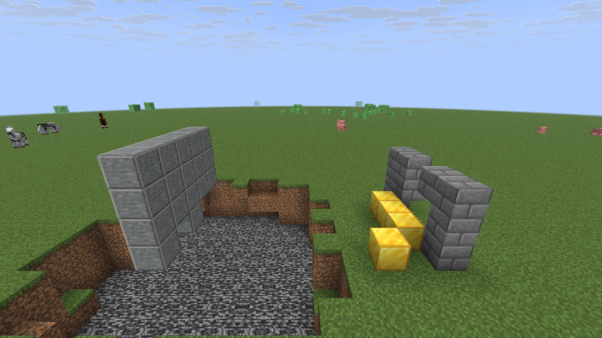
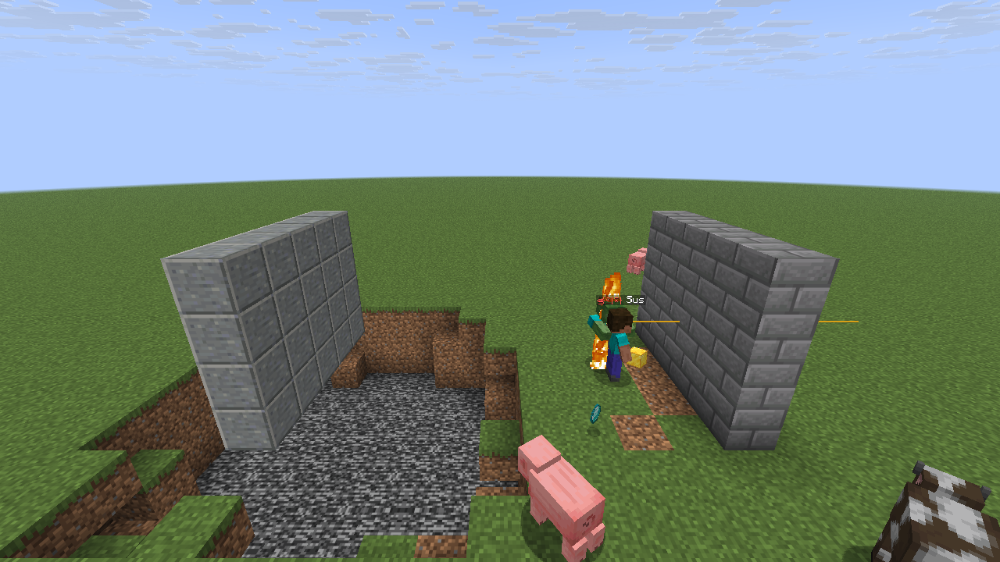
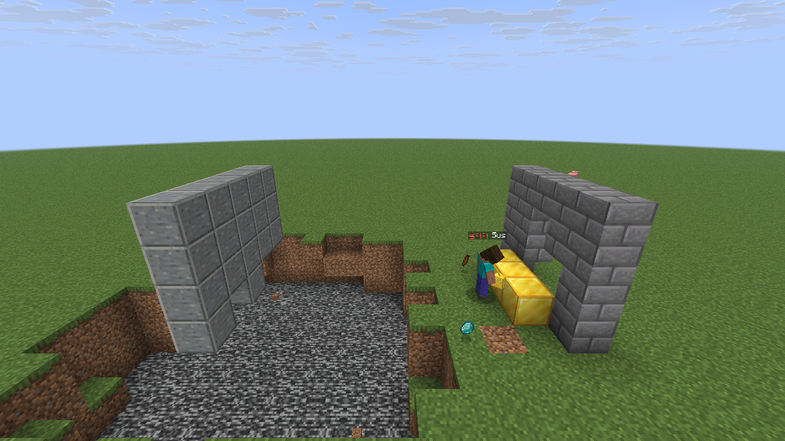
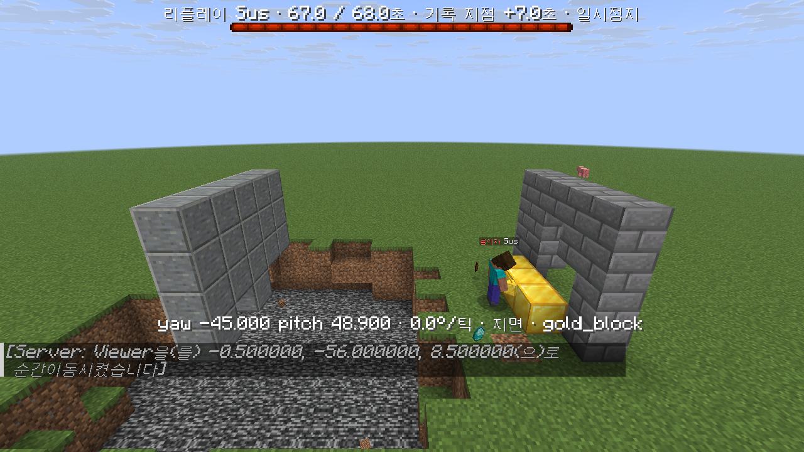

# RewindReplay

Paper/Folia 26.2용 게임 안 안티치트 리플레이입니다. 모든 플레이어의 최근 1분을 메모리에 담아 두고, 관리자가 의심
플레이어를 다시 볼 때 지금 월드가 아니라 그 순간의 몹과 블록 위에서 보여 줍니다.

Paper / Folia 26.2 · PacketEvents 2.14 · CoreProtect(선택) · Java 25 · GPL-3.0 · [English](README.md)

| 지금 월드 | 리플레이 0:40 | 리플레이 0:58 |
|---|---|---|
|  |  |  |
| 벽 윗줄이 없고 금 블록 4개, 지금 있는 몹(말, 슬라임). | 채굴 전: 벽이 온전하고, 녹화된 돼지·소·불타는 좀비·떨어진 다이아가 보입니다. 지금 몹은 숨겨집니다. | 벽에 구멍, 금 블록 3개. 클립이 끝날 때 그대로이고, 클립 뒤에 바뀐 것은 보이지 않습니다. |

실제 26.2 클라이언트로 찍은 실험 화면입니다. 클립 동안 봇이 돌벽돌 벽을 캐고 금 블록 3개를 놓았고, 클립이 끝난 뒤에
벽 윗줄을 더 캐고 금 블록 하나를 더 놓은 다음 몹을 모두 없앴습니다.

## 설치

1. [Releases](https://github.com/jayden0903/minecraft-anticheat-replay/releases/latest)에서 **RewindReplay-1.2.0.jar**를 받습니다.
2. [PacketEvents](https://modrinth.com/plugin/packetevents) 2.14 이상(필수)과 같이 `plugins/`에 넣습니다. [CoreProtect](https://modrinth.com/plugin/coreprotect)가 있으면 그때의 블록까지 보입니다(선택).
3. 서버를 재시작합니다.

```
/리플레이 기록 <플레이어>    지난 60초(+다음 30초) 저장
/리플레이 목록              최근 클립
/리플레이 보기 <id>         게임 안에서 보기(나만 보임)
```

Paper 또는 Folia 26.2 이상, Java 25.

## 왜 만들었나

지나간 일을 다시 보는 데는 두 가지 문제가 있습니다.

1. **누구를 녹화할지 미리 알 수 없습니다.** 신고나 안티치트 경고는 싸움이 끝난 뒤에 옵니다. RewindReplay는 접속한
   모든 플레이어의 최근 60초를 크기가 고정된 메모리 버퍼에 담아 두고, 누군가 표시했을 때만 클립을 디스크에 씁니다.
2. **실제 월드 안에서 보는 리플레이는 지금 월드를 보여 줍니다.** 녹화된 플레이어만 지금 맵 위에 그리면, 그 뒤에 캐인
   블록을 뚫고 지나가는 것처럼 보이고, 나중에 놓인 블록 옆에 서 있고, 이미 없는 몹에게 칼을 휘두르고, 나중에 온 몹과
   플레이어가 같이 보입니다. 엑스레이, ESP, 킬오라, 플라이를 판단해야 하는 바로 그 부분이 틀리게 보입니다.
   RewindReplay는 녹화된 몹과 아이템도 재생하고, CoreProtect 기록으로 그 순간의 블록을 다시 만들고, 지금 엔티티를
   숨깁니다. 모두 보는 사람 한 명에게만 패킷으로 보내므로 실제 월드는 바뀌지 않습니다.

## 기능

**녹화 (항상)**
- 접속한 모든 플레이어의 최근 60초를 클라이언트 틱 단위로 패킷에서 읽습니다. PacketEvents MONITOR 리스너는 패킷을
  막거나 바꾸지 않습니다. 위치, 받은 그대로의 yaw/pitch, 땅 위 여부, 달리기·웅크리기, 이동 키, 팔 휘두르기, 공격(대상과
  그 순간 대상 위치), 블록 캐기, 블록 부수기·놓기, 받은 피해, 든 아이템, 서버 텔레포트.
- 서버가 보는 자세와 상태를 매 틱(겉날개 활공, 수영, 급류, 기어가기, 잠, 아이템 사용, 방패, 탑승, 비행 허용, 물속),
  장비는 마법 부여 반짝임과 갑옷 장식까지 바뀔 때만 저장합니다.
- 플레이어마다 반경 24칸 안의 몹, 떨어진 아이템, 투사체, 보트·광산 수레, 점화된 TNT, 떨어지는 블록을 초당 10번.
- 플레이어당 메모리 고정. 타이머 핵은 메모리를 늘리지 못하고 기록 시간이 짧아질 뿐입니다. 채팅과 IP는 담지 않습니다.

**클립**
- `/replay mark <닉네임> [사유]`(관리자) 또는 `rewindreplay mark <닉네임> <사유>`(콘솔, 또는 안티치트 처벌 목록처럼
  콘솔 명령을 실행할 수 있는 다른 플러그인)로 표시하면 앞 60초와 뒤 30초를 저장합니다.
- 용의자에게 32칸 안까지 왔던 플레이어를 모두 넣습니다. 여러 사람이 본 같은 몹은 하나로 합칩니다.
- 2분 안에 나간 플레이어도 표시할 수 있습니다. 자동 표시는 플레이어별 대기 시간과 시간당 한도가 있고, 녹화가 끝나기
  전(30초)에 들어온 표시는 같은 클립에 사유만 더합니다.
- 열 단위 배열로 된 gzip JSON, 보통 70~120 KiB. 30일이 지나거나 합계 2 GiB를 넘으면 오래된 것부터 지웁니다.

**분석** (클립마다 저장, `/replay summary`로 출력)
- 공격 순간 조준: 시선과 대상 히트박스 중심 사이 각도(평균, 중앙값, p90, 최대), 시선이 히트박스 안이었던 공격 비율, 리치.
- 공격 직전 30° 이상 급회전과 공격 직후 되돌림(사일런트 오라), 십자선이 히트박스에 들어온 바로 그 틱에 공격한
  비율(트리거봇).
- 불투명 블록 뒤에 있는 플레이어를 겨눈 시간(ESP). 시야 검사는 그 지역을 가진 리전 스레드에서 합니다.
- 회전 속도, 초당 휘두르기, 수평 속도, 부수고 놓은 블록, 피해.
- 비행: 활공 시간과 속도, 그리고 설명할 것이 없는 공중 고속 이동 경고(활공·급류·탑승·비행 허용·물속·최근 넉백이
  아닌데 빠르게 이동).

**보기** (관리자 한 명, 패킷만)
- 관전 모드로 그 장소에 갑니다. 스킨·갑옷·겉날개·자세가 있는 가짜 플레이어, 녹화된 몹과 아이템, 그 순간의 블록.
- 용의자 눈에서 정확한 yaw/pitch로 나가는 시선 빛줄기: 노랑 = 보는 방향, 빨강 = 플레이어 히트박스 조준, 보라 = 벽 너머
  히트박스 조준, 흰색 = 공격. 조준당한 플레이어는 윤곽선이 켜집니다.
- 위쪽 막대에 클립 시각·기록 지점 기준 시각·배속, 아래 줄에 정확한 yaw/pitch, 틱당 회전 각도, 지면/공중, 자세, 든
  아이템, 대상과의 거리와 각도.
- 채팅 버튼: 재생/일시정지, ±10초, ±1초, ±1틱, 0.25~4배속, 기록 지점으로, 용의자 1인칭, 용의자 뒤로 이동, 요약, 종료.
- 다른 사람에게는 아무것도 보이지 않습니다(서버 엔티티 없음, 탭 목록 없음). 종료, 접속 끊김(다음 접속 때), 서버 재시작
  뒤에 보는 사람의 위치와 게임 모드를 돌려놓습니다.



*기록 지점 7초 뒤에서 일시정지: 위쪽 막대에 클립 시각과 기록 지점 기준 시각, 아래 줄에 용의자의 정확한 yaw/pitch,
틱당 회전, 지면 여부, 든 아이템.*

## 동작 방식

```
 클라이언트 패킷 ──► PacketEvents MONITOR 리스너 (넷티 스레드) ──┐
 플레이어 엔티티 스레드: 자세 매 틱, 장비 10틱마다,              ├──► 플레이어별 링버퍼 (크기 고정, 약 60초)
                         주변 엔티티 2틱마다 ────────────────────┘
                                     │  표시: 관리자, 콘솔, 다른 플러그인
                                     ▼
   io 스레드: 모든 링 복사, 30초 대기, 다시 복사, [표시 - 60초, 표시 + 30초]로 자르기, 32칸 안 플레이어만,
              엔티티 합치기, 조준 분석, 리전 스레드에서 시야 검사, gzip JSON과 index 한 줄 쓰기
                                     │  /replay view <번호>
                                     ▼
   io 스레드: 클립 읽기, 용의자 경로 주변 CoreProtect 조회, 블록 타임라인 만들기
   보는 사람 엔티티 스레드: 가짜 플레이어·엔티티, 그때 블록, 지금 엔티티 숨김. 패킷은 그 연결 하나에만
```

### 링버퍼

접속한 플레이어마다 `Recorder` 하나가 있고, 배열은 처음에 한 번만 만듭니다. 녹화 중에는 메모리를 새로 할당하지 않습니다.

| 링 | 크기(기본값) | 내용 |
|---|---|---|
| 프레임 | 1,500 (60초 × 20Hz + 여유 25%) | 시각, x/y/z(double), yaw/pitch(float), 플래그 21비트 + 핫바 칸, 든 아이템, 월드, 자세·상태 값, 장비 스냅샷 번호 |
| 이벤트 | 1,024 | 공격, 상호작용, 캐기, 블록에 사용, 블록 부수기·놓기, 받은 피해, 서버가 인정한 타격, 서버 텔레포트, 사망, 월드 이동, 리스폰 |
| 장비 | 스냅샷 128개 × int 9개 | 아이템 5개(반짝임 비트 포함) + 갑옷 장식 4개, 바뀔 때만 추가 |
| 엔티티 | 19,200행 (60초 × 초당 10번 × 32개) | 엔티티 id, 종류, 아이템·블록 데이터, x/y/z, yaw/pitch(1/256 바퀴), 플래그(불, 아기, 죽음, 맞음) |

`CLIENT_TICK_END` 패킷마다 프레임 하나를 확정합니다(이 패킷을 보내지 않는 클라이언트는 이동 패킷마다). 40ms보다
가까운 빈 프레임은 버리고, 초당 30프레임(순간 60) 토큰 버킷을 넘으면 앞 프레임에 합칩니다. 아이템·월드·엔티티 종류
같은 문자열은 전역 번호표로 바꿔 링에는 int만 담습니다.

| 스레드 (Folia) | 하는 일 |
|---|---|
| 플레이어의 넷티 이벤트 루프 | 패킷을 지금 프레임에 기록, 레코더 잠금 안에서 확정(복사하는 몇 µs 말고는 경합 없음) |
| 플레이어의 엔티티 스케줄러 | 자세·상태 매 틱, 핫바·장비 10틱마다(활공 시작·끝은 즉시), 주변 엔티티 2틱마다 |
| 리전 스레드 | Bukkit 이벤트: 피해, 블록 부수기·놓기, 사망, 리스폰, 월드·게임 모드 변경 |
| io 데몬 스레드 하나 | 클립 조립, 분석, gzip 입출력, 보관 정리, CoreProtect 조회 |
| 용의자 지역을 가진 리전 스레드 | 시야 검사, 틱당 150개. 로드되지 않았거나 다른 리전의 청크는 "검사 안 됨"으로 세고 절대 로드하지 않음 |
| 보는 사람의 엔티티 스케줄러 | 리플레이 세션. 패킷은 모아서 틱마다 한 번 보내고, 명령은 할 일만 큐에 넣음 |

### 클립 형식 3

클립 하나가 gzip JSON 파일 하나(`plugins/RewindReplay/clips/<날짜>/<번호>.json.gz`)이고, 임시 파일에 쓴 뒤 옮겨서
원자적으로 저장하며 `index.jsonl`에 한 줄을 더합니다. 프레임 데이터는 열 단위 배열이고, 위치와 각도는 받은 값과
비트 단위로 같습니다. 테스트가 만든 합성 예시는 [`samples/synthetic-clip-v3.json.gz`](samples/)에 있습니다.

```
{
  "format": "rewind-replay/3", "id": "<yyMMdd-HHmmss-xx>",
  "createdAtMs", "startWallMs", "markWallMs", "markOffsetMs", "durationMs",
  "suspect": {"name", "uuid"},  "reasons": [{"atMs", "source": "console | op:<이름>", "reason"}],
  "worlds": [...], "items": [...], "trims": ["", "minecraft:sentry minecraft:gold", ...],   // 문자열 표
  "flagsLegend": {...}, "stateLegend": {...}, "equipLegend": "...", "entityFlagsLegend": {...},
  "summary": {"headline", "attacks", "aim", "rotation", "hidden", "clicks", "movement", "flight", "flags", "blocks", "damage"},
  "tracks": [{                                   // 0번 = 용의자, 그다음 주변 플레이어
      "role", "name", "uuid", "client", "skin": {"value", "signature"},
      "n", "t": [클립 기준 ms], "x", "y", "z", "yaw", "pitch", "flags", "item", "world", "state",
      "equip": [[frame, head, chest, legs, feet, offhand, glintMask, trimHead, trimChest, trimLegs, trimFeet], ...],
      "los": [0 검사 안 됨 | 1 보임 | 2 가려짐],      // 용의자만, 프레임별 가장 가까운 대상
      "events": [{"t", "frame", "type", "entityId", "targetTrack", "target", "info", "block": [x, y, z], "pos", "amount"}]
  }],
  "entities": [{"id", "type", "data", "world", "n", "t", "x", "y", "z", "yaw", "pitch", "flags"}]
}
```

형식 2(1.1.0)에는 `entities`가 없고, 형식 1(1.0.0)에는 `state`, `equip`, `trims`도 없습니다. 둘 다 그대로 읽습니다.

### CoreProtect로 블록 되돌리기

클립에는 블록을 저장하지 않습니다. 클립을 열 때 io 스레드가 용의자 경로를 따라 조회 지점을 정하고(36칸 이동마다 하나,
최대 24개), 각 지점 반경 48칸에서 클립 시작부터 지금까지의 블록 부수기·놓기 기록을 CoreProtect에 묻습니다. 바뀐
위치마다:

- **클립 시작 때 상태** = 시작 뒤 첫 변화의 "이전" 쪽입니다. 부수기 기록이면 그 블록이 있었고, 놓기 기록이면 공기였습니다.
- **클립 동안의 변화** = 부수기는 공기로, 놓기는 놓은 블록으로, 기록된 초에 바뀝니다. 같은 위치에서 클립 속 플레이어가
  직접 부수거나 놓은 이벤트가 2초 안에 있으면 그 ms로 맞춥니다.
- 클립 뒤의 변화는 쓰지 않으므로 보이지 않습니다.

보는 쪽은 시작 상태를 보내고(16×16×16 구역마다 `SECTION_BLOCKS_UPDATE` 하나), 재생 위치가 지나가는 변화를 적용하고,
되감기·건너뛰기 때마다 그 시점 상태를 다시 계산하고, 24칸 넘게 움직였을 때와 2초마다 주변 블록을 다시 보냅니다(청크를
다시 받으면 클라이언트가 가짜 블록 변경을 버리기 때문). 종료하면 각 청크의 리전 스레드에서 읽은 지금 블록을 보냅니다.
CoreProtect를 쓰는 클래스는 `WorldHistory` 하나이고 CoreProtect가 켜져 있을 때만 로드됩니다(softdepend). 경로에서
가까운 위치 60,000곳까지만 씁니다.

### 패킷만 쓰는 보기 화면

- **플레이어**: 녹화된 스킨으로 탭 목록에 안 보이는 `PLAYER_INFO_UPDATE`, `SPAWN_ENTITY`, 그리고 매 틱 정확한 double
  위치로 텔레포트, 머리 방향, 자세·플래그 메타데이터, 장비(장비를 먼저 보냅니다. "아이템 사용" 플래그는 그 순간 그 손에
  든 것을 쓰게 하기 때문). 활공·급류 중에는 바닐라처럼 속도를 보내 몸이 기울게 합니다. 이름표는 보는 사람 전용 팀으로
  숨기고(윤곽선 색도 이 팀), 가짜마다 `TEXT_DISPLAY` 라벨을 태웁니다.
- **시선 빛줄기**: 눈 위치의 `BLOCK_DISPLAY`를 float yaw/pitch로 만든 쿼터니언 Ry(-yaw)·Rx(pitch)로 돌립니다. 보간 없음.
- **녹화된 엔티티**: 종류와 모든 엔티티에 공통인 메타데이터(공통 플래그, 중력 없음)만, 떨어진 아이템은 아이템까지
  보냅니다. 종류별 값은 빼서 잘못된 번호 때문에 보는 사람이 튕기는 일이 없게 했습니다.
- 엔티티 id는 바닐라보다 훨씬 큰 `0x7A000000`부터 씁니다. 틱당 가짜 플레이어 6명, 엔티티 24개까지만 만들고, 라벨
  갱신은 10틱에 나눠 보냅니다. PacketEvents 블록·아이템 매핑은 시작할 때 io 스레드에서 미리 데웁니다.
- 1인칭은 용의자 가짜에 `SET_CAMERA`를 걸고, 청크가 로드되도록 관전 중인 보는 사람을 따라 옮깁니다.

### 지금 엔티티 숨기기

두 번째 PacketEvents 리스너(MONITOR는 패킷을 막으면 안 되므로 NORMAL 우선순위)가 보는 사람에게 가는 살아 있는
엔티티(갑옷 거치대 제외), 아이템, 경험치 구슬, 투사체, 보트, 광산 수레, TNT, 떨어지는 블록의 `SPAWN_ENTITY`를 막습니다.
시작할 때 이미 보이던 반경 160칸 안의 엔티티는 클라이언트에서 지웁니다. 끝나면 아직 추적 범위 안에 있는 엔티티는
Bukkit API로 숨겼다가 다시 보여 서버가 다시 보내게 하고, 나머지는 범위에 다시 들어올 때 돌아옵니다.

## 측정한 비용

| 항목 | 결과 | 조건 |
|---|---|---|
| 패킷 기록(넷티 스레드) | 패킷당 522 ns(PacketEvents 해석 포함), 합계 코어 하나의 0.135% | 봇 60명, 20Hz, 120초 (1.0) |
| | 패킷당 609~638 ns | 갑옷 입은 봇 24명 (1.1) |
| 자세·장비 표본(엔티티 스레드) | 플레이어당 틱당 약 2.2 µs | 봇 24명, 150초 (1.1) |
| 주변 엔티티 표본(엔티티 스레드) | 1회 41 µs, 초당 10회: 플레이어당 초당 약 0.4 ms, 60명이면 코어 하나의 약 2.5%(리전 스레드들에 나뉨) | 실험 서버 (1.2) |
| 메모리 | 플레이어당 751 KiB(프레임·이벤트·장비 132 KiB + 엔티티 19,200행). 60명 44 MiB, 최근 퇴장 40명까지 최대 73 MiB | 배열 크기로 계산. 오프라인 벤치에서 엔티티 링 없는 레코더 60개의 힙은 7.9 MiB(계산 7.8 MiB) |
| 클립 저장(io 스레드) | 3명 클립 0.57~0.60초, 69~122 KiB. 60명이 모두 32칸 안이면 1.45초, 3.6 MiB | 실험 서버 (1.0) |
| 시야 검사(리전 스레드) | 틱당 150개, 틱당 평균 0.1~0.41 ms, 최대 1.9 ms | 실험 서버 (1.0) |
| 보기(보는 사람 리전 스레드, 보는 동안만) | 틱당 평균 76 µs, 최대 1.8 ms(처음 블록 보낼 때) | 몹과 되돌린 블록이 있는 실험 클립 (1.2) |
| | 3명 클립 틱당 0.15 ms, 45명 0.5 ms | 실험 서버 (1.0) |
| 클립 열 때 CoreProtect 조회 | 0.5초: 조회 5번, 기록 596줄, 위치 533곳, 클립 동안 변화 24곳 | 실제 채굴 클립 + 실서버 규모 CoreProtect DB 사본 |
| 시작할 때 미리 데우기 | 0.4~0.6초, 한 번, io 스레드 | 실험 서버 |

## 테스트

**오프라인 검사** (`python3 build.py test`, 서버 필요 없음): 링버퍼와 동시 복사, 폭주 방어, 클립 파일 비트 단위 왕복,
합성 에임봇·사람·트리거봇·사일런트 오라·ESP 용의자, 장비·자세 링, 엔티티 합치기, 비행 경고 사례, 형식 1·2 클립 읽기,
60명 비용 벤치. 실제 클립 폴더가 필요한 검사 2개는 `-Drr.oldclips=` / `-Drr.labclips=`를 줄 때만 돌고 기본은 건너뜁니다.
이름을 바꾼 뒤의 결과는 PASS 42개, SKIP 2개, FAIL 0개입니다(전체 출력은 [README.md](README.md#tests)). 공개 Paper API
26.2.build.123으로 컴파일했을 때와 이 플러그인을 개발한 서버의 Folia 26.2 API로 컴파일했을 때 모두 같습니다.

**게임 안** (실제 서버와 같은 서버 빌드·PacketEvents·CoreProtect·ViaVersion을 쓴 격리된 실험 서버. 실제 26.2
클라이언트, ViaVersion을 거친 1.21.11·26.3 클라이언트, mineflayer 봇. 스크립트는 [`lab/scenario.js`](lab/scenario.js)):
- 1.2: 0:40에는 벽이 온전, 0:51에는 일부 캐이고 금 블록 1개, 0:58에는 금 블록 3개였고, 녹화된 몹과 떨어진 다이아가
  보였습니다. 클립 뒤 변화는 보이지 않았고, 67초에서 44초로 되감자 벽이 다시 온전해졌고, 종료하자 지금 블록과 몹이
  돌아왔습니다. 실제 서버에서 1.0·1.1이 녹화한 클립(형식 1·2)도 그대로 열렸습니다.
- 1.1: 겉날개 활공 자세, 장식·반짝임이 있는 갑옷, 먹기, 방패 막기, 수영, 기어가기, 잠, 급류가 26.2·1.21.11·26.3
  클라이언트에서 맞게 보였습니다. 플라이 핵 봇은 경고가 떴고, 실제 클라이언트의 활공·급류·수영 클립은 뜨지 않았습니다.
- 1.0: 리플레이 바로 옆에 선 일반 플레이어에게는 아무것도 보이지 않았고 탭 목록에도 가짜가 없었습니다. 재생 중 강제
  종료한 클라이언트는 다시 들어왔을 때 원래대로 돌아왔습니다. 봇 싸움에서 에임봇 봇은 평균 오차 0.0°, 되돌림 24번,
  벽 뒤 대상 추적 16.5초, 사람 같은 봇은 3.7°, 0번, 0초였습니다.

1.0과 1.1은 실제 야생 서버에서 돌았고, 1.2.0은 실험 서버에서 확인했습니다.

## 한계

- **판정 도구가 아니라 증거 도구입니다.** 킥이나 밴은 하지 않습니다. 기준값(예: 비행 경고 초속 10칸 1초 초과, 급회전
  30°)은 사람 플레이 기준 없이 실험으로 정했습니다. 반드시 영상과 같이 보세요.
- **블록은 CoreProtect 기록만큼만 정확합니다.** 플레이어의 부수기·놓기, 폭발, 불, 물·용암 흐름, 자람, 피스톤은
  되돌립니다. 콘솔 명령이나 CoreProtect에 기록하지 않는 플러그인이 바꾼 블록, 문·다락문 열림, 상자 내용은 지금
  상태로 보입니다. CoreProtect 시간은 초 단위입니다(클립 속 플레이어가 직접 부수고 놓은 것은 정확). CoreProtect가
  지운 기간보다 오래된 기록은 없습니다. 조회는 용의자 경로 반경 48칸, 최대 60,000곳입니다.
- **가려진 대상 수치는 저장 시점의 블록을 씁니다**(되돌린 블록이 아님). 불투명한 꽉 찬 블록만 가리는 것으로 보므로
  유리·잎·반블록 뒤는 보이는 것으로 칩니다. 다른 리전이거나 로드되지 않은 청크는 "검사 안 됨"입니다.
- **엔티티는 대략적입니다.** 종류·위치·방향·불·맞음·죽음만 보입니다. 아기 크기, 색, 몹이 든 무기·갑옷은 보이지
  않습니다(잘못된 메타데이터 번호로 보는 사람이 튕기지 않게 일부러 뺐습니다). 플레이어 반경 24칸, 가까운 32개까지이고,
  매우 붐비는 곳은 엔티티 기록이 60초보다 짧아질 수 있습니다.
- 가짜 플레이어 머리 방향은 프로토콜 때문에 1/256 바퀴(1.4°) 단위입니다. 정확한 값은 빛줄기, 아래 줄, 요약에 있습니다.
- 장비는 10틱마다 확인하므로 갈아입은 순간이 최대 0.5초 늦게 보일 수 있습니다(활공 시작·끝은 즉시). 잠은 침대가 아니라
  몸 방향으로 눕고, 꽂힌 화살과 효과 입자는 재생하지 않습니다.
- 초당 30프레임(순간 60)까지만 담습니다. 더 빨리 보내는 클라이언트는 기록 시간이 짧아집니다.
- 플레이어가 아닌 공격 대상은 서버가 인정한 타격일 때만 위치가 있습니다.
- 보는 사람은 실제 관전 모드라서 다른 사람 탭 목록에 이름이 회색으로 보입니다.
- 개인정보: 접속한 모든 플레이어의 움직임을 60초 동안 메모리에 두고, 표시했을 때만 디스크에 씁니다(채팅·IP는 담지
  않음). 서버 규칙이나 개인정보 안내에 적어 두세요.
- 게임 안 테스트는 Folia 26.2에서 했습니다. 공개 Paper API 26.2로 컴파일되지만 Folia가 아닌 Paper 서버에서는 아직
  돌려 보지 않았습니다.

## 필요한 것

- Paper 또는 Folia 26.2 (Paper API만 쓰며 `folia-supported: true`)
- [PacketEvents](https://github.com/retrooper/packetevents) 2.14 플러그인(필수)
- [CoreProtect](https://github.com/PlayPro/CoreProtect) API 9 이상(선택. 없으면 블록은 지금 상태). CoreProtect 24.0으로 확인
- 빌드에 JDK 25

## 빌드

`javac`와 `jar`를 부르는 Python 스크립트 하나로 빌드합니다(Gradle·Maven 필요 없음). 컴파일 클래스패스에 다음 jar가
필요합니다(빌드를 확인한 버전이며, 다른 26.2 빌드도 될 것입니다).

| Jar | 받는 곳 |
|---|---|
| `paper-api-26.2.build.123-stable.jar` (또는 Folia API 26.2 jar) | `io.papermc.paper:paper-api`, [Paper Maven 저장소](https://repo.papermc.io/repository/maven-public/) |
| `adventure-api-5.2.0.jar`, `adventure-key-5.2.0.jar` | `net.kyori`, Maven Central |
| `gson-2.14.0.jar` | `com.google.code.gson:gson`, Maven Central |
| `guava-33.6.0-jre.jar` | `com.google.guava:guava`, Maven Central |
| `bungeecord-chat-1.21-R0.2-deprecated+build.21.jar` | `net.md-5:bungeecord-chat`, Paper Maven 저장소 |
| `annotations-26.1.0.jar` | `org.jetbrains:annotations`, Maven Central (paper-api 클래스 파일 때문에 javac만 필요) |
| `packetevents-spigot-2.14.0.jar` | PacketEvents 릴리스 |
| `CoreProtect-24.0.jar` (API 9+) | CoreProtect 릴리스 (컴파일에 필요, 서버에서는 선택) |

넣는 방법은 세 가지입니다.

```bash
# 1. jar를 libs/에 넣고 (git에는 안 올라감)
python3 build.py                       # -> build/RewindReplay.jar

# 2. 한 번 켠 적 있는 Paper/Folia 26.2 서버 폴더를 쓰기
#    (서버 jar가 libraries/ 아래 API 라이브러리 목록을 갖고 있고, PacketEvents·CoreProtect는 plugins/에서)
python3 build.py --server /path/to/server

# 3. 클래스패스를 직접 주기
RR_CLASSPATH=/a/paper-api.jar:/b/packetevents-spigot.jar:... python3 build.py

python3 build.py test                  # 오프라인 검사, 클래스패스 방법은 같음
```

JDK는 `--jdk`, `JAVA_HOME`, `PATH` 순서로 찾습니다. 컴파일 전에 클래스패스를 검사해서 빠진 API를 알려 줍니다.

## 설치

1. PacketEvents를 설치합니다(그때 블록까지 보려면 CoreProtect도).
2. `build/RewindReplay.jar`를 `plugins/`에 넣고 서버를 재시작합니다(`/reload`는 쓰지 마세요).
3. 로그에 `enabled: 60 s + 30 s clips, 1500 frames/1024 events/19200 entity rows per player (751 KiB); blocks from
   CoreProtect: yes`와 `viewer mappings warmed up`이 나오는지 봅니다.
4. 선택: 안티치트가 표시하게 합니다. 콘솔 명령이면 무엇이든 되며, 예를 들어 Grim `punishments.yml`에서:
   ```yaml
   commands:
     - "15:15 rewindreplay mark %player% Grim Combat VL %vl%"
   ```

## 명령어

권한 `rewindreplay.admin`(기본: OP). 하위 명령은 `/replay`와 `/리플레이` 어느 쪽에서도 영어·한국어 모두 됩니다.

| 명령 | 한국어 | 하는 일 |
|---|---|---|
| `/replay mark <닉네임> [사유]` | `/리플레이 기록` | 앞 60초와 뒤 30초를 클립으로 저장 |
| `/replay list [닉네임]` | `/리플레이 목록` | 최근 클립 10개, [보기]·[요약] 버튼 |
| `/replay view <번호>` | `/리플레이 보기` | 게임 안에서 재생(본인에게만 보임) |
| `/replay summary <번호>` | `/리플레이 요약` | 분석 수치 출력 |
| `/replay stop` | `/리플레이 종료` | 재생을 끝내고 원래 자리로 |
| `/replay status` | `/리플레이 상태` | 메모리, 녹화 단계별 CPU, 저장, 보는 사람 |
| `/replay control <동작>` | `/리플레이 제어` | 채팅 버튼용: `pause`, `back10`, `back1`, `prev`, `next`, `fwd1`, `fwd10`, `s025`, `s05`, `s1`, `s2`, `s4`, `mark`, `restart`, `pov`, `goto`, `summary`, `controls`, `stop`, `at <초>` |
| `/replay resetstats` | | 상태 통계 초기화 |
| `rewindreplay mark <닉네임> <사유>` | | 콘솔·다른 플러그인용. 하위 명령은 `/replay`와 같음 |

콘솔·다른 플러그인의 표시는 플레이어별 대기 시간과 시간당 한도를 같이 쓰고, 관리자가 직접 한 표시는 건너뛰지 않습니다.
메시지와 채팅 버튼은 한국어입니다.

## 설정

`plugins/RewindReplay/config.yml`. 바꾼 값은 재시작 뒤에 적용됩니다.

| 키 | 기본값 | 뜻 |
|---|---|---|
| `buffer-seconds` | 60 | 플레이어마다 담아 두고 표시 앞쪽으로 저장하는 시간 |
| `after-seconds` | 30 | 표시 뒤에 더 녹화하는 시간 |
| `frame-slack-percent` | 25 | 몰려 오는 연결을 위한 여유 프레임 |
| `event-cap` | 1024 | 플레이어당 이벤트 링 크기 |
| `nearby-radius` | 32 | 용의자에게 이만큼 가까이 온 플레이어를 넣음 |
| `recent-quit-seconds` | 120 | 나간 플레이어를 이 시간까지 표시할 수 있음 |
| `max-recent-quit` | 40 | 나간 플레이어 레코더를 최대 몇 개까지 둘지 |
| `console-cooldown-seconds` | 120 | 같은 플레이어에 대한 자동 표시를 이 시간 안에는 건너뜀 |
| `max-clips-per-hour` | 60 | 자동 표시 시간당 한도 |
| `max-pending` | 12 | 동시에 녹화·저장 중인 클립 수 |
| `retention-days` | 30 | 이보다 오래된 클립은 지움 |
| `max-total-mb` | 2048 | 합계가 이보다 크면 오래된 클립부터 지움 |
| `line-of-sight.enabled` | true | 가려진 대상 수치 |
| `line-of-sight.max-candidates` | 2400 | 클립당 검사할 프레임 수(공격 프레임은 항상) |
| `line-of-sight.per-tick` | 150 | 리전 틱당 시야 검사 수 |
| `notify-staff-on-auto-mark` | false | 자동 표시가 저장되면 접속한 관리자에게 알림 |
| `entities.enabled` | true | 주변 몹·아이템·투사체·탈것·TNT·떨어지는 블록 녹화 |
| `entities.radius` | 24 | 플레이어 주변 반경(칸) |
| `entities.interval-ticks` | 2 | N틱마다 한 번 |
| `entities.max-per-sample` | 32 | 한 번에 가까운 N개 |
| `world-history.enabled` | true | 클립을 열 때 CoreProtect로 블록을 되돌림 |
| `world-history.radius` | 48 | 용의자 경로 주변 반경(칸) |
| `world-history.max-blocks` | 60000 | 최대 위치 수(경로에서 가까운 순) |
| `hide-live-entities` | true | 보는 동안 지금 몹·플레이어 숨김 |

## 폴더 구성

```
build.py                               빌드·테스트 스크립트 (javac + jar)
src/main/java/io/github/jayden0903/replay/
  RewindReplay.java                    플러그인: 패킷 리스너, 엔티티 스레드 표본, 이벤트, 보기 수명 주기, 상태
  Recorder.java                        플레이어별 링버퍼 (프레임, 이벤트, 장비, 엔티티)
  ClipService.java                     표시, 30초 추가 녹화, 클립 조립, 엔티티 합치기, index, 보관 정리
  Clip.java                            클립 모델과 gzip JSON 읽기·쓰기 (형식 1~3)
  Analyzer.java                        조준, 급회전, 트리거봇, 가려진 대상, 비행 수치
  Los.java                             리전 스레드에서 복셀 시야 검사
  WorldHistory.java, BlockTimeline.java  CoreProtect 조회와 블록 타임라인
  ReplaySession.java                   패킷만 쓰는 보기 화면
  ReplayCmd.java, Settings.java, Names.java
src/main/resources/plugin.yml, config.yml
src/test/java/.../VerifyReplay.java    오프라인 검사
samples/synthetic-clip-v3.json.gz      검사가 만든 합성 클립
lab/scenario.js                        스크린샷에 쓴 봇 시나리오
docs/images/                           스크린샷
```

## 라이선스

GPL-3.0, [LICENSE](LICENSE) 참고. PacketEvents도 GPL-3.0이고, CoreProtect는 공개 API로만 씁니다.
