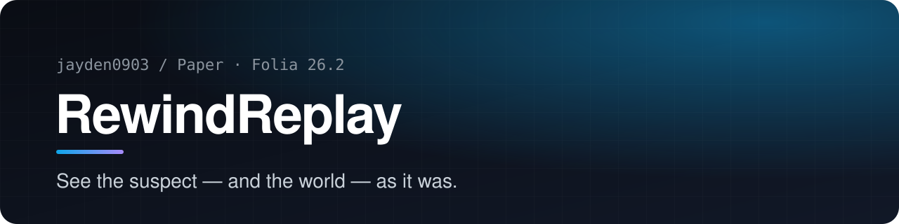
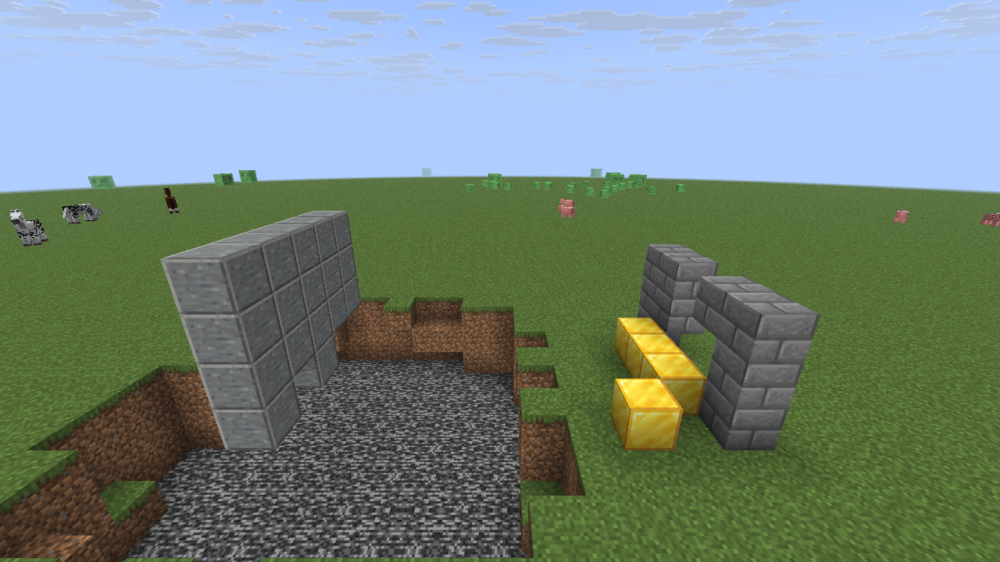
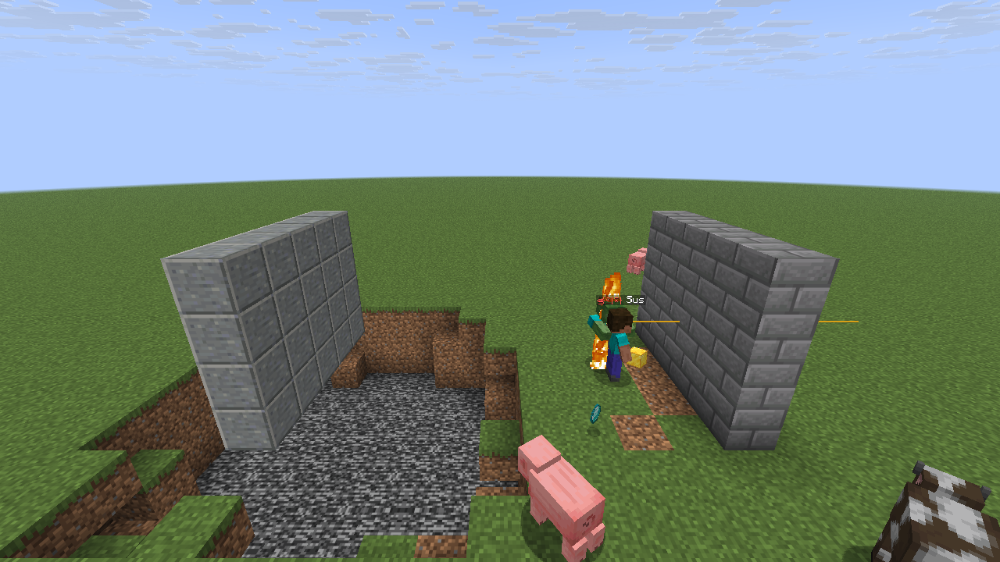
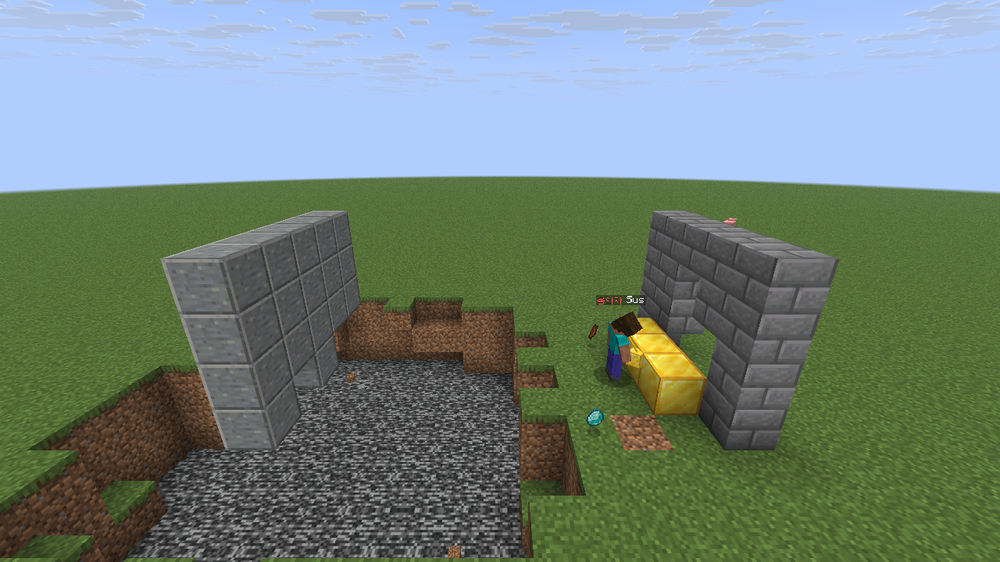
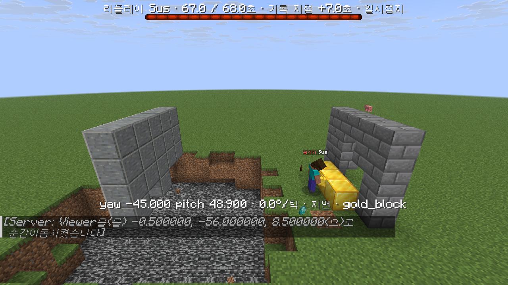

<!-- readme-v2 -->
<p align="center"></p>

<p align="center">   <a href="README.ko.md"></a></p>

<p align="center">An in-game anticheat replay: the last minute of every player, replayed with <b>the mobs and blocks of that moment</b> — not today's world.</p>

<table>
<tr><td align="center" width="25%"><h3>60 s</h3><sub>of every player, always</sub></td><td align="center" width="25%"><h3>Then</h3><sub>blocks rebuilt from CoreProtect</sub></td><td align="center" width="25%"><h3>Packets</h3><sub>only the viewer sees it</sub></td><td align="center" width="25%"><h3>Fixed</h3><sub>memory per player</sub></td></tr>
</table>

| Today | Replay at 0:40 | Replay at 0:58 |
|---|---|---|
|  |  |  |
| The wall's top row is gone, four gold blocks, today's mobs (horses, slimes). | Before the mining: wall intact, the recorded pig, cow, burning zombie and dropped diamond. Today's mobs are hidden. | A hole in the wall and three gold blocks, as at the end of the clip. Changes made after the clip do not appear. |

### Build

```bash
python3 build.py                       # -> build/RewindReplay.jar
```

### Details

<details>
<summary><b>Overview</b></summary>

An in-game anticheat replay for Paper/Folia 26.2: it keeps the last minute of every player in memory and lets staff
watch a suspect again with the mobs and the blocks as they were at that moment, not as they are today.


Lab test with a real 26.2 client. During the clip a bot mined into the stone-brick wall and placed three gold blocks.
After the clip it dug out the top row, placed a fourth gold block, and every mob was killed.

</details>

<details>
<summary><b>Why</b></summary>

Watching a suspect after the fact has two problems.

1. **Nobody knows in advance whom to record.** Reports and anticheat alerts arrive after the fight. RewindReplay keeps
   the last 60 s of every online player in fixed-size memory buffers and writes a clip to disk only when someone marks a
   player.
2. **A replay inside the live world shows today's world.** Recorded players drawn over the current map walk through
   blocks that were mined since, stand next to blocks placed later, swing at mobs that are gone, and share the scene
   with mobs and players who arrived afterwards. For judging x-ray, ESP, kill aura or fly, the picture is wrong exactly
   where it matters. RewindReplay also replays the recorded mobs and items, rebuilds the blocks of that moment from
   CoreProtect's history and hides today's entities. Everything is sent as packets to the one viewer; the real world is
   never changed.

</details>

<details>
<summary><b>Features</b></summary>

**Recording (always on)**
- Last 60 s of every online player at client tick rate, read from packets by a PacketEvents MONITOR listener that never
  cancels or edits a packet: position, yaw/pitch exactly as received, ground flag, sprint/sneak, movement keys, swings,
  attacks with the target's position, digging, block break/place, damage taken, held item, server teleports.
- Server pose and state every tick (elytra glide, swimming, riptide, crawling, sleeping, item use, shield, riding,
  allowed flight, in water) and equipment with enchantment glint and armour trims, stored only when it changes.
- Mobs, dropped items, projectiles, boats/minecarts, primed TNT and falling blocks within 24 blocks of each player,
  10 samples per second.
- Fixed memory per player. A timer cheat shortens the covered time instead of growing memory. No chat, no IP addresses.

**Clips**
- `/replay mark <player> [reason]` (staff) or `rewindreplay mark <player> <reason>` (console, or any plugin that can run
  a console command, such as an anticheat's punishment list) saves 60 s before and 30 s after the mark.
- The clip includes every player who came within 32 blocks of the suspect. A mob seen by several players is one entity.
- Players who left up to 2 minutes earlier can still be marked. Automatic marks have a per-player cooldown and an hourly
  cap; a mark during the 30 s continuation adds its reason to the clip being recorded.
- gzip JSON with column arrays, typically 70-120 KiB. Retention by age (30 days) and total size (2 GiB).

**Analysis** (stored in each clip, printed by `/replay summary`)
- Aim at attack time: angle between the look vector and the target's hitbox centre (mean, median, p90, max), share of
  attacks with the look ray inside the hitbox, reach.
- Snaps of 30° or more into an attack and straight back after it (silent aura); share of attacks in the tick the
  crosshair entered the hitbox (triggerbot).
- Time spent aiming at a player hidden behind opaque blocks (ESP), with line of sight checked on the region thread that
  owns the area.
- Rotation speed, swings per second, horizontal speed, blocks broken and placed, damage.
- Flight: glide time and speeds, and a review flag for fast airborne movement that nothing explains (no glide, riptide,
  vehicle, allowed flight, water or recent knockback).

**Viewer** (one staff member, packets only)
- Spectator mode at the scene. Fake players with skins, armour, elytra and poses; the recorded mobs and items; the
  blocks of that moment.
- Look ray from the suspect's eye at the exact yaw/pitch: yellow = looking, red = on a player's hitbox, purple = on a
  hitbox behind a wall, white = attack. The player being aimed at glows.
- Boss bar with the clip time, offset from the mark and speed; action bar with exact yaw/pitch, degrees per tick,
  ground or air, pose, held item, and distance and angle to the target.
- Chat-button controls: play/pause, ±10 s, ±1 s, ±1 tick, 0.25x to 4x, jump to the mark, first person through the
  suspect's eyes, move to the suspect, summary, stop.
- Nobody else sees anything (no server entities, no tab-list entries). The viewer's position and game mode are restored
  on stop, on disconnect (at the next join) and after a server restart.



*Paused 7 s after the mark: the boss bar shows clip time and offset from the mark, the action bar the suspect's exact
yaw/pitch, rotation per tick, ground state and held item.*

</details>

<details>
<summary><b>How it works</b></summary>

```
 client packets ──► PacketEvents MONITOR listener (netty threads) ──┐
 player's entity thread: pose every tick, equipment every 10 ticks, ├──► per-player ring buffers (fixed size, ~60 s)
                         nearby entities every 2 ticks ─────────────┘
                                         │  mark: staff, console or another plugin
                                         ▼
   io thread: copy every ring, wait 30 s, copy again, cut to [mark - 60 s, mark + 30 s], keep players within 32 blocks,
              merge entities, analyse aim, line of sight on the owning region thread, write gzip JSON + index line
                                         │  /replay view <id>
                                         ▼
   io thread: read the clip, query CoreProtect around the suspect's path, build the block timeline
   viewer's entity thread: fake players and entities, past blocks, today's entities hidden; packets to one connection
```

### Ring buffers

Each online player has a `Recorder` whose arrays are allocated once; recording never allocates.

| Ring | Size (defaults) | Content |
|---|---|---|
| Frames | 1,500 (60 s × 20 Hz + 25 % slack) | time, x/y/z (double), yaw/pitch (float), 21 flag bits + hotbar slot, held item, world, pose/state word, equipment snapshot reference |
| Events | 1,024 | attack, interact, dig, use on block, block break/place, damage taken, confirmed hit, server teleport, death, world change, respawn |
| Equipment | 128 snapshots × 9 ints | 5 items with glint bit + 4 armour trims, appended only when something changed |
| Entities | 19,200 rows (60 s × 10 samples/s × 32) | entity id, type, item/block data, x/y/z, yaw/pitch (1/256 turn), flags (fire, baby, dead, hurt) |

A frame is committed on each `CLIENT_TICK_END` packet (one frame per movement packet for clients that do not send it).
Empty frames less than 40 ms apart are dropped, and beyond a token bucket of 30 frames/s (burst 60) a frame is merged
into the previous one. Strings (items, worlds, entity types) go through a global intern table, so the rings hold ints.

| Thread (Folia) | Work |
|---|---|
| Player's netty event loop | Packets into the current frame; commit under the recorder's lock (uncontended except during a microsecond copy) |
| Player's entity scheduler | Pose/state every tick, hotbar and equipment every 10 ticks (at once when gliding starts or stops), nearby entities every 2 ticks |
| Region threads | Bukkit events: damage, block break/place, death, respawn, world and game-mode changes |
| One io daemon thread | Clip assembly, analysis, gzip I/O, retention, CoreProtect lookups |
| Region thread that owns the suspect's area | Line-of-sight rays, 150 per tick; unloaded chunks or chunks of another region count as "unchecked" and are never loaded |
| Viewer's entity scheduler | The replay session; packets are batched and flushed once per tick; commands only queue actions |

### Clip format 3

One gzip JSON file per clip (`plugins/RewindReplay/clips/<date>/<id>.json.gz`), written atomically (temp file + move),
plus one line in `index.jsonl`. Per-frame data is stored as column arrays; positions and angles are bit-exact as
received. A synthetic example generated by the tests is in [`samples/synthetic-clip-v3.json.gz`](samples/).

```
{
  "format": "rewind-replay/3", "id": "<yyMMdd-HHmmss-xx>",
  "createdAtMs", "startWallMs", "markWallMs", "markOffsetMs", "durationMs",
  "suspect": {"name", "uuid"},  "reasons": [{"atMs", "source": "console | op:<name>", "reason"}],
  "worlds": [...], "items": [...], "trims": ["", "minecraft:sentry minecraft:gold", ...],   // string tables
  "flagsLegend": {...}, "stateLegend": {...}, "equipLegend": "...", "entityFlagsLegend": {...},
  "summary": {"headline", "attacks", "aim", "rotation", "hidden", "clicks", "movement", "flight", "flags", "blocks", "damage"},
  "tracks": [{                                   // index 0 = suspect, then nearby players
      "role", "name", "uuid", "client", "skin": {"value", "signature"},
      "n", "t": [ms on the clip timeline], "x", "y", "z", "yaw", "pitch", "flags", "item", "world", "state",
      "equip": [[frame, head, chest, legs, feet, offhand, glintMask, trimHead, trimChest, trimLegs, trimFeet], ...],
      "los": [0 unchecked | 1 visible | 2 hidden],   // suspect only, for the best target per frame
      "events": [{"t", "frame", "type", "entityId", "targetTrack", "target", "info", "block": [x, y, z], "pos", "amount"}]
  }],
  "entities": [{"id", "type", "data", "world", "n", "t", "x", "y", "z", "yaw", "pitch", "flags"}]
}
```

Format 2 (1.1.0) has no `entities`; format 1 (1.0.0) also has no `state`, `equip` or `trims`. Both are still read.

### Blocks from CoreProtect

Clips store no blocks. When a clip is opened, the io thread places lookup centres along the suspect's path (one per
36 blocks travelled, at most 24) and asks CoreProtect for block breaks and places within 48 blocks of each, from the
clip start until now. For every changed position:

- **state at the clip start** = the "before" side of the first change after the start: a logged break means that block
  was there; a logged place means it was air;
- **changes during the clip** = breaks become air, places become the placed block, at the logged second, refined to the
  exact millisecond when a clip player's own break/place event at that position lies within 2 s;
- changes after the clip are ignored, so they never show up.

The viewer sends the start state (one `SECTION_BLOCKS_UPDATE` per 16×16×16 section), applies changes as the cursor
passes them, recomputes the state on every seek, and re-sends the blocks around the viewer after moving 24 blocks and
every 2 s (the client drops fake block changes when it reloads a chunk). On stop it sends today's real blocks, read on
each chunk's own region thread. `WorldHistory` is the only class that touches CoreProtect and is loaded only when
CoreProtect is enabled (soft dependency); at most 60,000 positions nearest the path are kept.

### Packet-only viewer

- **Players**: tab-unlisted `PLAYER_INFO_UPDATE` with the recorded skin, `SPAWN_ENTITY`, then per tick a teleport with
  the exact double position, head rotation, pose/flag metadata and equipment (equipment before metadata, because a
  "using item" flag makes the client use whatever is in that hand). While gliding or riptiding the velocity is sent like
  vanilla, so the client rolls the body. Name tags are hidden by a viewer-only team, which also colours the glow; a
  `TEXT_DISPLAY` label rides on each fake.
- **Look ray**: a `BLOCK_DISPLAY` at the eye, rotated by the quaternion Ry(-yaw)·Rx(pitch) built from the float yaw/pitch,
  without interpolation.
- **Recorded entities**: spawned with their type and only the metadata every entity has (shared flags, no gravity) plus
  the item stack for dropped items. Per-type fields are left out, so a wrong index can never disconnect the viewer.
- Entity ids start at `0x7A000000`, far above vanilla ids. At most 6 fake players and 24 entities are spawned per tick,
  and label updates are spread over 10 ticks. PacketEvents' block and item mappings are warmed up on the io thread at
  startup.
- First person uses `SET_CAMERA` on the suspect's fake; the spectating viewer is teleported along so chunks stay loaded.

### Hiding today's entities

A second PacketEvents listener (NORMAL priority, because the MONITOR listener must not cancel) drops `SPAWN_ENTITY`
packets to the viewer for living entities (except armour stands), items, experience orbs, projectiles, boats,
minecarts, TNT and falling blocks. Entities the viewer already sees within 160 blocks are destroyed client-side at the
start. At the end, entities still in tracking range are hidden and shown again through the Bukkit API so the server
re-sends them; the rest come back when they re-enter range.

</details>

<details>
<summary><b>Measured cost</b></summary>

| What | Result | Setup |
|---|---|---|
| Packet recording (netty threads) | 522 ns per packet including PacketEvents decoding, 0.135 % of one core in total | 60 bots at 20 Hz for 120 s (1.0) |
| | 609-638 ns per packet | 24 bots with armour (1.1) |
| Pose and equipment sampling (entity threads) | about 2.2 µs per player per tick | 24 bots, 150 s (1.1) |
| Nearby-entity sampling (entity threads) | 41 µs per sample at 10 samples/s: about 0.4 ms per player per second, about 2.5 % of one core for 60 players spread over the region threads | lab (1.2) |
| Memory | 751 KiB per player (132 KiB frames, events and equipment + 19,200 entity rows); 44 MiB for 60 players, at most 73 MiB including 40 recently quit players | computed from the array sizes; the offline bench measures 7.9 MiB of heap for 60 recorders without the entity ring (computed: 7.8 MiB) |
| Clip save (io thread) | 0.57-0.60 s and 69-122 KiB for a 3-player clip; 1.45 s and 3.6 MiB with 60 players within 32 blocks | lab (1.0) |
| Line of sight (region thread) | 150 rays per tick; 0.1-0.41 ms average, 1.9 ms maximum per tick | lab (1.0) |
| Viewer (viewer's region thread, only while watching) | 76 µs average per tick, 1.8 ms maximum (first block send) | lab clip with mobs and rewound blocks (1.2) |
| | 0.15 ms per tick for a 3-player clip, 0.5 ms for 45 players | lab (1.0) |
| CoreProtect lookup when a clip is opened | 0.5 s: 5 lookups, 596 rows, 533 positions, 24 changes during the clip | a real mining clip against a copy of a production-size CoreProtect database |
| Viewer warm-up at startup | 0.4-0.6 s, once, on the io thread | lab |

</details>

<details>
<summary><b>Tests</b></summary>

**Offline verifier** (`python3 build.py test`, no server needed): ring buffers and concurrent copies, flood guard,
bit-exact clip round trip, synthetic aimbot / human / triggerbot / silent-aura / ESP suspects, equipment and pose
rings, entity merge, flight-flag cases, reading of format 1 and 2 clips, and a 60-player cost bench. Two optional checks
read real clip folders and are skipped unless `-Drr.oldclips=` / `-Drr.labclips=` is given.

<details>
<summary>Output after the rename (42 PASS, 2 SKIP; compiled against the public Paper API 26.2.build.123)</summary>

```
PASS ring keeps the newest 100 frames (100, 150.0..249.0)
PASS event ring keeps the newest 16 events
PASS incremental copy from a sequence
PASS empty tick-end flood (0.1 ms apart) does not flush the ring (3 frames)
PASS 400 frames/s flood is merged to <= 30 frames/s + burst (209 frames kept, last position kept)
PASS copies taken while another thread records are consistent (19671 copies)
PASS clip file round trip is bit-exact for positions and float yaw/pitch (61 KiB gz)
PASS summary survives the round trip
PASS aimbot: attack aim error ~0 deg
PASS aimbot: crosshair on the hitbox > 95 % of the time
PASS human model: attack aim error several degrees
PASS triggerbot: attacks in the tick the crosshair enters the box
PASS human model: most attacks not in the entry tick
PASS silent aura: snap-backs counted, none for the human model
PASS ESP model: long tracking of a hidden target is measured (19.95 s)
PASS equipment ring: only changes are stored (3 snapshots for 300 frames), frames point at the right snapshot
PASS state word per frame (glide bits, main-hand glint split from the item id)
PASS equipment ring overflow (400 changes > 128): newest exact, oldest frames use the oldest kept snapshot
PASS format 2 clip saved through ClipService
PASS equipment stored as changes only (2 entries for 600 frames): netherite+trim, then glinted elytra
PASS glide state per frame survives the file (200 frames)
PASS summary: 10 s fall-flying at 30 b/s, not flagged
PASS entity ring keeps the newest 256 rows (256, 236.0..299.0)
PASS incremental entity copy
PASS format 3 clip: 2 tracks, 2 entities (2)
PASS the zombie both players saw is one entity, samples merged (200 samples, >= 40 ms apart)
PASS dropped item keeps its material and position
PASS entity flags and rotation survive (on fire later, yaw 64/256)
PASS block position packing round trip (negative, world border, build limits)
PASS fly flag: air 15 b/s 2 s, not gliding -> flagged (2.0 s)
PASS fly flag: air 15 b/s 0.9 s, not gliding -> not flagged (0.0 s)
PASS fly flag: air 15 b/s 2 s, gliding -> not flagged (0.0 s)
PASS fly flag: air 25 b/s 2 s, riptide -> not flagged (0.0 s)
PASS fly flag: air 15 b/s 2 s, riding -> not flagged (0.0 s)
PASS fly flag: air 15 b/s 2 s, creative flight -> not flagged (0.0 s)
PASS fly flag: ground 15 b/s 2 s -> not flagged (0.0 s)
PASS fly flag: air 9 b/s 3 s -> not flagged (0.0 s)
PASS fly flag: air 15 b/s for 3 s with a server teleport (setback) every 0.5 s is still flagged (2.65 s longest run)
PASS fly flag: 0.8 s coasting after a glide ends is not flagged (1 s grace)
PASS format 1 clip (synthetic) loads and analyzes: no state, no equipment, poseData=false
PASS format 2 clip (synthetic) loads and analyzes: state + equipment, no entities
SKIP real format 1 clips (set -Drr.oldclips=dir to read them)
SKIP lab clip re-analysis (set -Drr.labclips=dir to run it)
  memory: 1500 frames + 1024 events per player = 132 KiB; 60 players = 7.77 MiB; +40 recent quits = 12.95 MiB
  measured heap for 60 recorders: 7.89 MiB
  record: 252137 packet operations (60 players x 90 s of 20 Hz traffic) in 30.7 ms on 4 threads = 487 ns/op
  mark -> saved clip: 639 ms (finalize 629 ms), 2214 KiB, 60 candidate tracks
PASS bench clip saved
ALL PASS
```
</details>

The same 42 checks also pass when compiled against the Folia 26.2 API of the server the plugin was developed on.

**In game** (an isolated lab server with the same server build, PacketEvents, CoreProtect and ViaVersion as a live
server; real 26.2 clients, 1.21.11 and 26.3 clients through ViaVersion, mineflayer bots; script in
[`lab/scenario.js`](lab/scenario.js)):
- 1.2: the replay showed the wall intact at 0:40, partly mined with one gold block at 0:51 and three at 0:58, with the
  recorded mobs and the dropped diamond; changes made after the clip did not appear; seeking from 67 s back to 44 s
  restored the wall; stopping brought back today's blocks and mobs. Clips recorded on a live server by 1.0 and 1.1
  (formats 1 and 2) still opened.
- 1.1: elytra glide pose, armour with trims and glint, eating, shield blocking, swimming, crawling, sleeping and riptide
  looked right on 26.2, 1.21.11 and 26.3 viewers. A fly-hack bot was flagged; glide, riptide and swim clips of a real
  client were not.
- 1.0: a non-staff player standing next to the replay saw nothing and the tab list had no fakes; a client killed during
  a replay was restored on rejoin. In scripted bot fights an aimbot bot showed 0.0° mean attack error, 24 snap-backs and
  16.5 s of tracking a target behind a wall; a human-like bot showed 3.7°, none and 0 s.

Versions 1.0 and 1.1 have run on a live survival server; 1.2.0 was verified on the lab server.

</details>

<details>
<summary><b>Limits</b></summary>

- **Evidence, not a verdict.** Nothing is kicked or banned. The thresholds (for example 10 blocks/s for over 1 s for the
  flight flag, 30° for a snap) were chosen in the lab without a baseline of human play; always watch the clip.
- **Blocks are only as good as CoreProtect's log.** Player breaks and places, explosions, fire, fluid flow, growth and
  pistons are rewound. Blocks changed by console commands or other plugins that do not log to CoreProtect, door and
  trapdoor toggles, and container contents show today's state. CoreProtect times are whole seconds (the clip players'
  own breaks and places are exact). History older than CoreProtect's purge window is gone. Lookups cover 48 blocks
  around the suspect's path and at most 60,000 positions.
- **The hidden-target metric uses the blocks at save time**, not the rewound ones, and only occluding blocks: glass,
  leaves and slabs do not hide a target. Chunks owned by another region or not loaded are counted as unchecked.
- **Entities are approximate.** Type, position, rotation, fire, hurt flash and death only; no baby size, colours or
  held items and armour of mobs (left out deliberately: a wrong metadata index would disconnect the viewer). Within
  24 blocks of a player and the nearest 32; in very crowded places the entity history is shorter than 60 s.
- Fake player heads turn in 1/256-turn steps (1.4°) because of the protocol; exact values are in the look ray, the
  action bar and the summary.
- Equipment is sampled every 10 ticks, so a change can appear up to 0.5 s late (gliding starts and stops are
  immediate). Sleeping fakes lie along their body yaw; stuck arrows and effect particles are not replayed.
- At most 30 frames per second are kept (burst 60): a client sending faster gets a shorter window.
- Attack targets that are not players have a position only when the server confirmed the hit.
- The viewer is a real spectator, so other players see the name in grey in the tab list.
- Privacy: every online player's movement is held in memory for 60 s and written to disk only on a mark (never chat or
  IP addresses). Mention it in your server rules or privacy notice.
- Tested in game on Folia 26.2. It compiles against the public Paper API 26.2 but has not been run on a non-Folia Paper
  server.

</details>

<details>
<summary><b>Requirements</b></summary>

- Paper or Folia 26.2 (the plugin uses only the Paper API and declares `folia-supported: true`)
- [PacketEvents](https://github.com/retrooper/packetevents) 2.14 installed as a plugin (required)
- [CoreProtect](https://github.com/PlayPro/CoreProtect) with API version 9 or newer (optional; without it blocks show
  today's state). Verified with CoreProtect 24.0.
- JDK 25 to build

</details>

<details>
<summary><b>Build</b></summary>

The build is a single Python script that calls `javac` and `jar`; no Gradle or Maven is needed. It needs these jars on
the compile classpath (the versions the build was verified with; other 26.2 builds should work):

| Jar | Source |
|---|---|
| `paper-api-26.2.build.123-stable.jar` (or a Folia API 26.2 jar) | `io.papermc.paper:paper-api`, [Paper's Maven repository](https://repo.papermc.io/repository/maven-public/) |
| `adventure-api-5.2.0.jar`, `adventure-key-5.2.0.jar` | `net.kyori`, Maven Central |
| `gson-2.14.0.jar` | `com.google.code.gson:gson`, Maven Central |
| `guava-33.6.0-jre.jar` | `com.google.guava:guava`, Maven Central |
| `bungeecord-chat-1.21-R0.2-deprecated+build.21.jar` | `net.md-5:bungeecord-chat`, Paper's Maven repository |
| `annotations-26.1.0.jar` | `org.jetbrains:annotations`, Maven Central (only javac needs it, for the paper-api class files) |
| `packetevents-spigot-2.14.0.jar` | PacketEvents releases |
| `CoreProtect-24.0.jar` (API 9+) | CoreProtect releases (needed to compile; optional on the server) |

Three ways to provide them:

```bash
# 1. put the jars into libs/ (ignored by git) and run
python3 build.py                       # -> build/RewindReplay.jar

# 2. use a Paper/Folia 26.2 server folder that has been started once
#    (its server jar lists the API libraries under libraries/; PacketEvents and CoreProtect come from plugins/)
python3 build.py --server /path/to/server

# 3. pass an explicit classpath
RR_CLASSPATH=/a/paper-api.jar:/b/packetevents-spigot.jar:... python3 build.py

python3 build.py test                  # offline verifier, same classpath options
```

The JDK is taken from `--jdk`, `JAVA_HOME` or `PATH`. The script checks the classpath before compiling and names any
missing API.

</details>

<details>
<summary><b>Install</b></summary>

1. Install PacketEvents (and CoreProtect if you want historical blocks).
2. Copy `build/RewindReplay.jar` into `plugins/` and restart the server (do not use `/reload`).
3. Check the log for `enabled: 60 s + 30 s clips, 1500 frames/1024 events/19200 entity rows per player (751 KiB); blocks
   from CoreProtect: yes` and `viewer mappings warmed up`.
4. Optional: let your anticheat mark players. Any console command works, for example in Grim's `punishments.yml`:
   ```yaml
   commands:
     - "15:15 rewindreplay mark %player% Grim Combat VL %vl%"
   ```

</details>

<details>
<summary><b>Commands</b></summary>

Permission `rewindreplay.admin` (default: op). Sub-commands work in English and Korean under both `/replay` and
`/리플레이`.

| Command | Korean | What it does |
|---|---|---|
| `/replay mark <player> [reason]` | `/리플레이 기록` | Freeze 60 s before and 30 s after into a clip |
| `/replay list [player]` | `/리플레이 목록` | The 10 newest clips with [보기] (view) and [요약] (summary) buttons |
| `/replay view <id>` | `/리플레이 보기` | Watch the clip in game (only you see it) |
| `/replay summary <id>` | `/리플레이 요약` | Print the analysis numbers |
| `/replay stop` | `/리플레이 종료` | End the replay and return to where you were |
| `/replay status` | `/리플레이 상태` | Memory, CPU per recording stage, saves, viewers |
| `/replay control <action>` | `/리플레이 제어` | Used by the chat buttons: `pause`, `back10`, `back1`, `prev`, `next`, `fwd1`, `fwd10`, `s025`, `s05`, `s1`, `s2`, `s4`, `mark`, `restart`, `pov`, `goto`, `summary`, `controls`, `stop`, `at <seconds>` |
| `/replay resetstats` | | Reset the status counters |
| `rewindreplay mark <player> <reason>` | | Console and other plugins; same sub-commands as `/replay` |

Marks from the console or other plugins share a per-player cooldown and an hourly cap; marks typed by staff are never
skipped. Messages and chat buttons are in Korean.

</details>

<details>
<summary><b>Configuration</b></summary>

`plugins/RewindReplay/config.yml`; changes apply after a restart.

| Key | Default | Meaning |
|---|---|---|
| `buffer-seconds` | 60 | History kept per player and saved before a mark |
| `after-seconds` | 30 | Recording continues this long after a mark |
| `frame-slack-percent` | 25 | Extra frame slots for bursty connections |
| `event-cap` | 1024 | Event ring size per player |
| `nearby-radius` | 32 | Other players who came this close to the suspect are included |
| `recent-quit-seconds` | 120 | A player who left can still be marked this long |
| `max-recent-quit` | 40 | Recorders of players who left kept at most |
| `console-cooldown-seconds` | 120 | Automatic marks for the same player inside this window are skipped |
| `max-clips-per-hour` | 60 | Cap for automatic marks |
| `max-pending` | 12 | Clips being recorded or saved at the same time |
| `retention-days` | 30 | Clips older than this are deleted |
| `max-total-mb` | 2048 | Above this total size the oldest clips are deleted |
| `line-of-sight.enabled` | true | Hidden-target metrics |
| `line-of-sight.max-candidates` | 2400 | Frames checked per clip (attack frames always) |
| `line-of-sight.per-tick` | 150 | Rays per region tick |
| `notify-staff-on-auto-mark` | false | Tell online staff when an automatic mark was saved |
| `entities.enabled` | true | Record nearby mobs, items, projectiles, vehicles, TNT, falling blocks |
| `entities.radius` | 24 | Blocks around each player |
| `entities.interval-ticks` | 2 | One sample every N ticks |
| `entities.max-per-sample` | 32 | Nearest N entities per sample |
| `world-history.enabled` | true | Rebuild blocks from CoreProtect when a clip is opened |
| `world-history.radius` | 48 | Blocks around the suspect's path |
| `world-history.max-blocks` | 60000 | Positions kept at most (nearest the path) |
| `hide-live-entities` | true | Hide today's mobs and players while watching |

</details>

<details>
<summary><b>Project layout</b></summary>

```
build.py                               build and test script (javac + jar)
src/main/java/io/github/jayden0903/replay/
  RewindReplay.java                    plugin: packet listener, entity-thread sampler, events, viewer lifecycle, status
  Recorder.java                        per-player ring buffers (frames, events, equipment, entities)
  ClipService.java                     marks, 30 s continuation, clip assembly, entity merge, index, retention
  Clip.java                            clip model and gzip JSON reader/writer (formats 1-3)
  Analyzer.java                        aim, snap, triggerbot, hidden-target and flight metrics
  Los.java                             voxel line of sight on the owning region thread
  WorldHistory.java, BlockTimeline.java  CoreProtect lookup and block timeline
  ReplaySession.java                   the packet-only viewer
  ReplayCmd.java, Settings.java, Names.java
src/main/resources/plugin.yml, config.yml
src/test/java/.../VerifyReplay.java    offline verifier
samples/synthetic-clip-v3.json.gz      synthetic clip written by the verifier
lab/scenario.js                        bot scenario used for the screenshots
docs/images/                           screenshots
```

</details>

<details>
<summary><b>License</b></summary>

GPL-3.0, see [LICENSE](LICENSE). PacketEvents is GPL-3.0 as well; CoreProtect is used only through its public API.

</details>


<p align="center"><sub>Made by <a href="https://github.com/jayden0903">jayden0903</a></sub></p>
